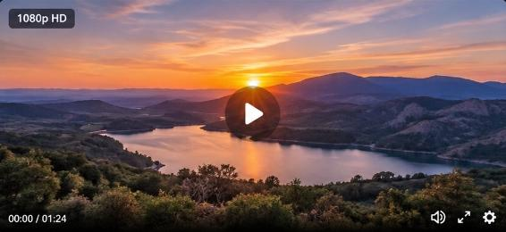

# 🎬 VideoPro Edit | محرر الفيديو الشامل وأداة التقطيع الذكية

منصة متكاملة لتحرير ومونتاج الفيديو عبر الويب مع أدوات معالجة متقدمة مدعومة بمحرك FFmpeg والذكاء الاصطناعي.



---

## ✨ المميزات الرئيسية

### 1. ⚡ تقطيع الفيديو الذكي والتلقائي (Smart Video Splitter)
- تقطيع أي فيديو (10 دقائق، ساعة، إلخ) بنقرة واحدة إلى مقاطع متساوية:
  - **كل ٣٠ ثانية**: مثالي لـ YouTube Shorts و Instagram Reels و TikTok.
  - **كل دقيقة (٦٠ ثانية)**: مثالي لحالات WhatsApp ومنشورات إنستغرام.
  - **كل دقيقتين (١٢٠ ثانية)**: للمقاطع الطويلة والبودكاست.
  - **تقطيع مخصص**: تحديد مدة كل مقطع يدوياً بالثواني أو الدقائق.
- **تنزيل فوري**: إمكانية تنزيل جميع المقاطع دفعة واحدة في ملف مضغوط **ZIP** أو تنزيل كل مقطع بشكل منفصل.
- **سرعة فائقة (Stream Copy)**: تقطيع فوري بدون فقدان جودة وبدون إعادة تشفير بطيئة.

### 2. 📱 تحويل الفيديو إلى مقاسات مختلفة مع إعادة ضبط الكادر
- التحويل إلى **9:16** (عمودي للهواتف والسوشيال ميديا).
- التحويل إلى **16:9** (أفقي قياسي لليوتيوب والشاشات).
- التحويل إلى **1:1** (مربع انستغرام وفيسبوك).
- خيار **الخلفية الضبابية الذكية (Smart Blur Background)** للحفاظ على كامل أبعاد الفيديو الأصلي بشكل جمالي أنيق.
- خيار **قص الكادر الذكي (Center Crop)** لتعبئة الشاشة بالكامل.

### 3. 🎯 استخراج أفضل اللقطات (AI Highlights & Shorts)
- تحليل ديناميكي للمشاهد والتغيرات البصرية ومستويات الصوت.
- استخراج أفضل المشاهد وتحويلها إلى مقاطع قصيرة جاهزة للنشر.

### 4. 🎙️ حذف فترات الصمت تلقائياً (Jump Cut & Silence Removal)
- فحص المقطع الصوتي واكتشاف السكون والوقفات الصامتة.
- حذف فترات الصمت تلقائياً ودمج الكلام بسلاسة وبإيقاع سريع وجذاب.

### 5. 📝 ترجمة تلقائية احترافية وتخصيص الخطوط والألوان
- تفريغ الكلام إلى نصوص وتوقيت تلقائي دقيق بالملي ثانية.
- دعم متعدد اللغات (عربي، إنجليزي، فرنسي، تركي، إسباني).
- تخصيص شكل ولون خط الترجمة (أصفر، أبيض، ذهبي، كاريوكي) وتصدير ملفات **SRT / VTT**.

### 6. 🎚️ تايم لاين تفاعلي متعدد المسارات (Multi-Track Timeline)
- شريط لقطات الفيديو المصغرة (Filmstrip).
- شريط تمثيل موجة الصوت الحي (Audio Waveform).
- شريط كتل الترجمة المتزامنة.
- مؤشر تشغيل تفاعلي (Playhead Scrubber) مع عرض توقيت دقيق بالملي ثانية `00:00:15.00`.

---

## 🚀 التشغيل المحلي (Local Setup)

### المتطلبات:
- Python 3.10+
- FFmpeg مثبت على النظام (`sudo apt install ffmpeg` أو عبر `brew install ffmpeg`)

### خطوات التشغيل:
```bash
# الانتقال لمجلد المشروع
cd videopro-edit

# إنشاء بيئة افتراضية
python3 -m venv venv
source venv/bin/activate

# تثبيت الحزم المطلوبة
pip install -r backend/requirements.txt

# تشغيل الخادم
python3 backend/app.py
```
افتح المتصفح على: `http://localhost:8000`

---

## 🐳 التشغيل عبر Docker

```bash
docker build -t videopro-edit .
docker run -p 8000:8000 videopro-edit
```

---

## ☁️ النشر على خادم Render أو السحابة

المشروع جاهز للنشر الفوري على **Render**:
1. أنشئ Web Service جديد من مستودع GitHub:
   `https://github.com/muradalmuard75-lgtm/videopro-edit`
2. اختر **Docker Runtime**.
3. المنفذ: `8000`.
4. انقر **Deploy** وسيبدأ بالعمل فوراً.

---

## 🤖 برومبت الوكلاء البرمجيين (AI Agents Prompt)
للتعاون مع وكلاء الذكاء الاصطناعي (Cursor, Copilot, Claude Engineer) في تطوير هذا المشروع، راجع ملف:
`AGENT_PROMPT.md`
